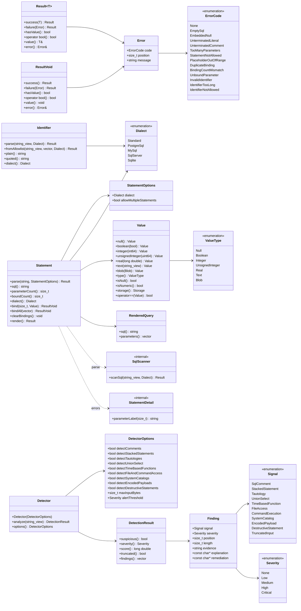

# Class Diagram

The diagram is textual so it can be reviewed in a diff. It describes the public API and the main internal dependency.



## Relationships

- `Statement::parse` returns `Result<Statement>`. `Statement::render` returns `Result<RenderedQuery>`.
- `Statement::bind` and `Statement::bindAll` return `Result<void>`.
- `Identifier::parse` and `Identifier::fromAllowlist` return `Result<Identifier>`.
- `Value` is a tagged variant. `RenderedQuery` owns a `std::vector<Value>` in slot order.
- `Detector` owns `DetectorOptions` and returns `DetectionResult` by value. `DetectionResult` owns `std::vector<Finding>`.
- `detail::scanSql` is an internal lexer not installed as a public header. It returns `Result<SqlScan>`.

## Lifetime and ownership

| Type | Ownership |
|---|---|
| `Value` | value semantics, copyable, `long double` for real values |
| `Identifier` | value semantics; owns plain and quoted strings |
| `Statement` | value semantics; owns SQL template, placeholder offsets, and bind slots |
| `RenderedQuery` | value semantics; owns native SQL and parameter values |
| `Detector` | value semantics; owns options; `analyze` is stateless |
| `DetectionResult` | value semantics; owns findings |
| `Result<T>` | value semantics; owns either a `T` or an `Error` |

## Error path

```text
parse failure ───────────────> Result<Statement>::failure(Error)
bind failure ────────────────> Result<void>::failure(Error)
render failure ──────────────> Result<RenderedQuery>::failure(Error)
identifier failure ──────────> Result<Identifier>::failure(Error)
```

No public method throws a library-specific exception. `value()` has a precondition: the result must contain a value.
